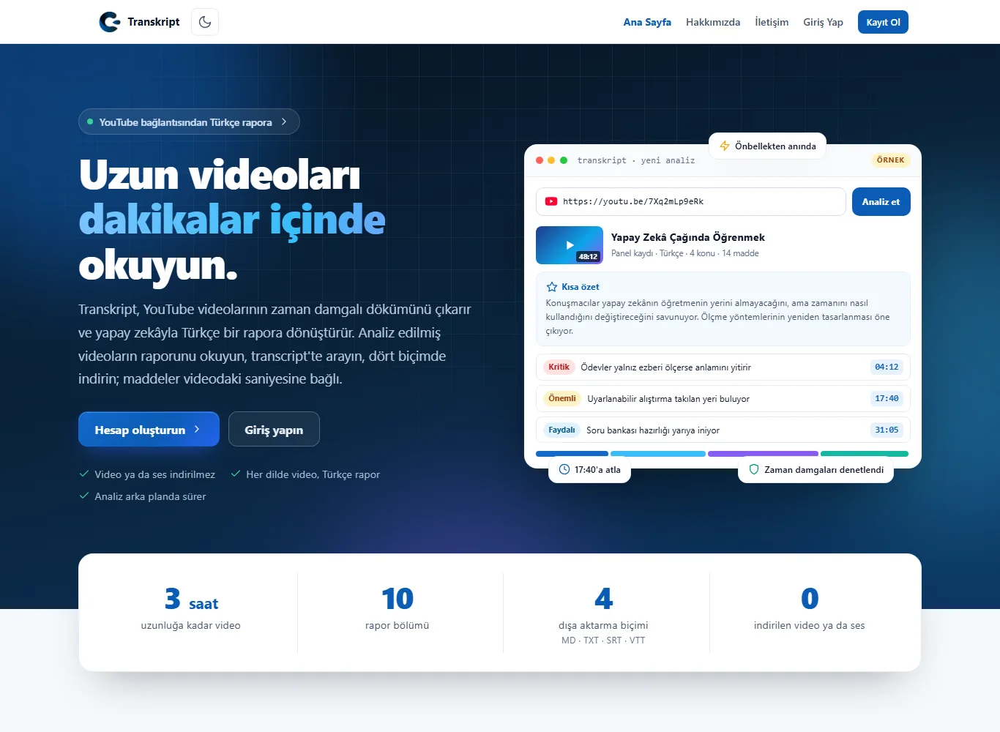
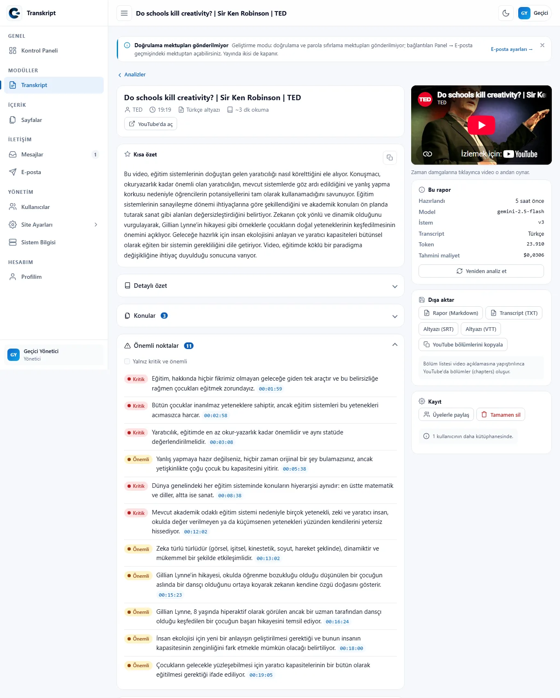
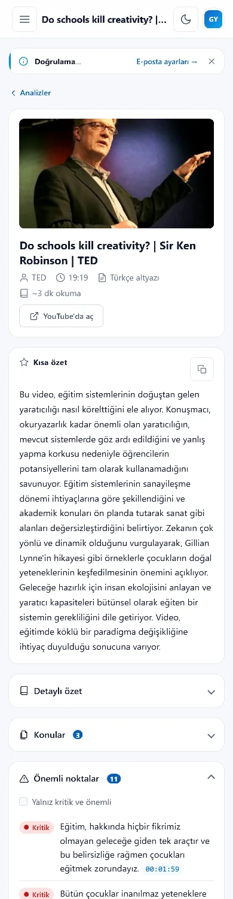
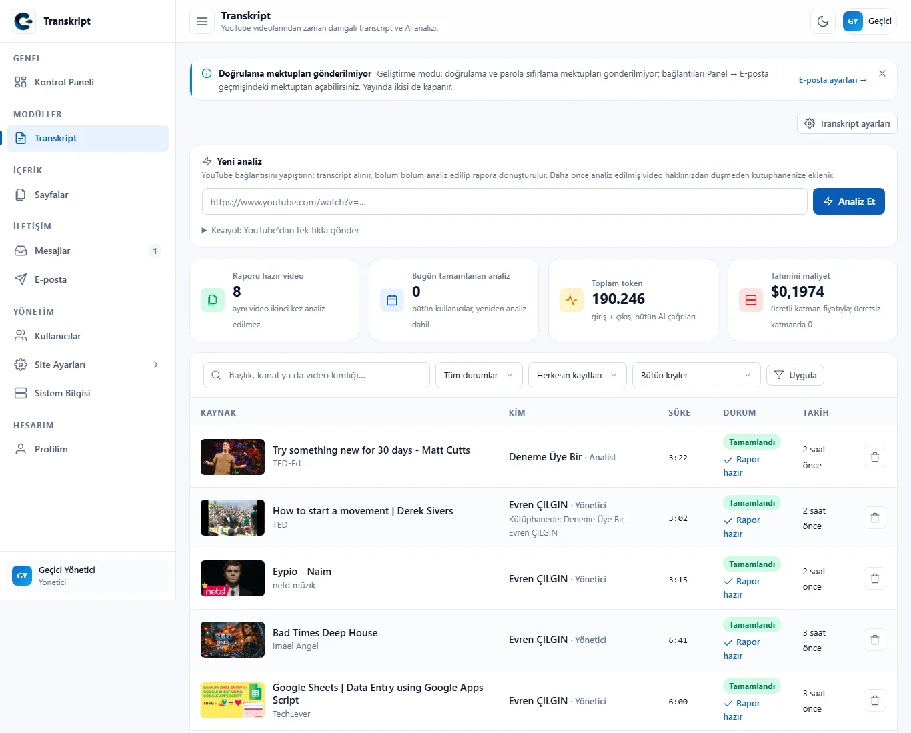
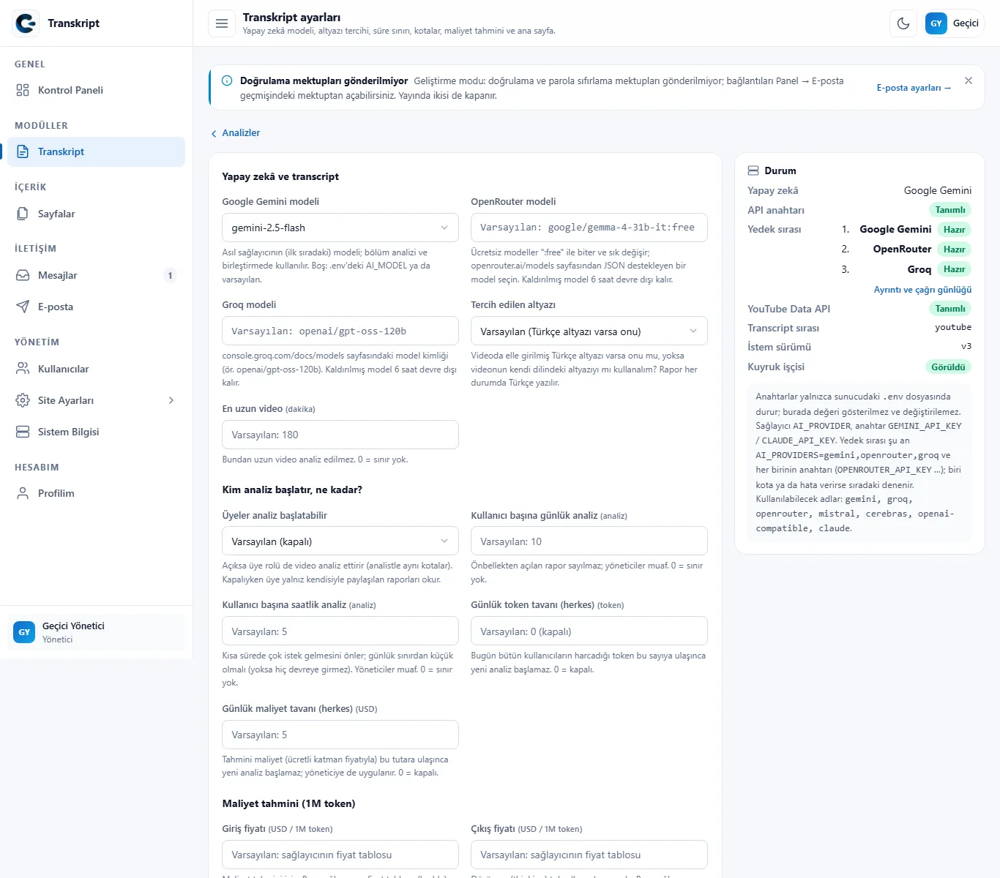

# Transkript: YouTube videolarından zaman damgalı Türkçe rapor

[](https://www.php.net/)
[](#kurulum)
[](#mimari)
[](LICENSE)
[](#testler)

**Transkript**, bir YouTube bağlantısını alır, videonun zaman damgalı dökümünü
(transcript) çıkarır ve yapay zekâyla **Türkçe bir rapora** dönüştürür. Rapordaki
her madde videodaki saniyesine bağlıdır: tıklayınca gömülü oynatıcı o andan başlar.
Uzun bir konuşmayı, dersi ya da podcast'i izlemeden önce dakikalar içinde okursunuz.

Aynı video ikinci kez yapay zekâya gitmez. Bir kullanıcı analiz ettirdiğinde rapor
ortak önbelleğe girer; başkası aynı bağlantıyı gönderdiğinde rapor hakkından düşmeden
kendi kütüphanesine eklenir.



## İçindekiler

- [Ne yapar?](#ne-yapar)
- [Ekranlar](#ekranlar)
- [Nasıl çalışır?](#nasıl-çalışır)
- [Roller](#roller)
- [Kurulum](#kurulum)
- [Yapay zekâ sağlayıcıları](#yapay-zekâ-sağlayıcıları)
- [REST API](#rest-api)
- [Testler](#testler)
- [Güvenlik ve gizlilik](#güvenlik-ve-gizlilik)
- [Mimari](#mimari)
- [Yol haritası](#yol-haritası)
- [Geliştirici ve lisans](#geliştirici-ve-lisans)

## Ne yapar?

- **Rapor:** kısa özet, detaylı özet, konular, önemli noktalar (kritik / önemli /
  faydalı), zaman çizelgesi, teknik bilgiler, iddialar ve fikirler. Video hangi dilde
  olursa olsun rapor Türkçe yazılır.
- **Zaman damgaları denetlenir:** yapay zekânın verdiği her saniye gerçek transcript
  satırlarına çekilir; tutmayan zaman damgası rapora girmez.
- **Transcript'te arama:** Türkçe harf duyarsız arama, eşleşen yer vurgulanır,
  satıra tıklayınca video o saniyeden oynar.
- **Dışa aktarma:** rapor (Markdown), transcript (TXT), altyazı (SRT / VTT) ve
  video açıklamasına yapıştırılınca YouTube bölümleri oluşturan liste.
- **Kişisel kütüphane:** herkes yalnız kendi analizlerini görür. Yönetici bir raporu
  "Üyelerle paylaş" ile herkese açabilir. Yönetici listesinde her kaydın kim
  tarafından başlatıldığı görünür ve kişiye göre süzülür.
- **Kotalar:** kullanıcı başına günlük ve saatlik analiz hakkı, herkes için günlük
  token ve maliyet tavanı. Önbellekten açılan rapor ve hiç yapay zekâ çağrısı yapmadan
  biten analiz haktan düşmez.
- **Yedekli yapay zekâ zinciri:** Google Gemini, OpenRouter ve Groq'un ücretsiz
  katmanları sırayla denenir. Kotası dolan sağlayıcı açılış saatine kadar dinlenir;
  hepsi dinlenirken analiz hata vermez, en erken açılışta kendiliğinden sürer.
- **Arka planda çalışır:** analiz kuyruk işlerinde yürür, sayfa canlı ilerleme
  gösterir. Kuyruk işçisi yoksa açık bir panel sayfası işleri tarayıcı üzerinden de
  işletebilir.
- **Yönetim:** Kontrol Paneli'nde sağlayıcı durumu, kuyruk ve son analizler;
  ayarlardan her sağlayıcının modeli, kotalar ve maliyet tahmini; yönetici parola
  sormadan bir üyenin gözünden paneli gezebilir.
- **REST API:** aynı işlemler `Authorization: Bearer` anahtarıyla.

## Ekranlar

| Rapor | Telefonda rapor |
|---|---|
|  |  |

| Analiz listesi (yönetici) | Transkript ayarları |
|---|---|
|  |  |

## Nasıl çalışır?

```
YouTube bağlantısı
  → kaynak bilgisi       başlık, kanal, süre (YouTube Data API, yoksa oEmbed)
  → önbellek             video daha önce analiz edildiyse rapor hemen açılır
  → transcript           YouTube altyazısı; yoksa Gemini'ye video bağlantısı
  → temizle ve parçala   ~8-10 dakikalık bölümler, 30 sn örtüşme
  → bölüm analizi (map)  her bölüm ayrı yapay zekâ çağrısı, satır başı [hh:mm:ss]
  → birleştir (reduce)   tek rapor
  → doğrula              JSON şeması, zaman damgaları gerçek satırlara çekilir
  → rapor
```

Her adım bir kuyruk işidir (`KaynakBilgisiAl → TranskriptAl → ParcaAnalizEt × N →
AnalizBirlestir → RaporuTamamla`). İş iki kez çalışsa bile biten bölüm ikinci kez
yapay zekâya gitmez. Promptlar sürümlüdür (`modules/Transkript/prompts/`) ve
raporla birlikte kaydedilir.

**YouTube'dan ses ya da video indirilmez.** Yalnız herkese açık altyazı okunur;
altyazısı olmayan videoda Gemini'ye video bağlantısı verilir.

## Roller ve üyelik planları

Kayıt olan herkes **Ücretsiz** plandadır. **Pro** ücretli üyeliktir: yönetici
ödemeyi görünce panelden süreli olarak verir, süre dolunca hesap kendiliğinden
Ücretsiz'e döner. Sınırlar ve fiyat Transkript ayarlarından değişir.

| | Yönetici | Pro Üye | Üye (Ücretsiz) |
|---|:---:|:---:|:---:|
| Analiz başlatma | sınırsız | günde 20, saatte 5 | günde 2, saatte 1 (kapatılabilir) |
| En uzun video | 180 dk | 180 dk | 30 dk |
| Önceden analiz edilmiş videoyu açma (haktan düşmez) | ✓ | ✓ | ✓ |
| Yeniden analiz, altyazı (SRT / VTT) indirme | ✓ | ✓ | |
| Kendi kütüphanesi | ✓ | ✓ | ✓ |
| Herkesin analizleri, "Kim" sütunu | ✓ | | |
| Raporu üyelerle paylaşma, tamamen silme | ✓ | | |
| Token ve maliyet bilgisi | ✓ | | |
| API anahtarı | ✓ | ✓ | |
| Pro üyelik verme, uzatma, kaldırma | ✓ | | |
| Kullanıcılar, site ve Transkript ayarları | ✓ | | |

Kurallar tek yerdedir: `TranskriptPolicy` (PHP) ve onun SQL karşılığı
`KaynakRepository::gorunurluk()`. Ayrıntılı tablo: [modules/Transkript/README.md](modules/Transkript/README.md).

## Kurulum

**Gereksinimler:** PHP 8.1+ (`pdo_mysql`, `mbstring`, `curl`; `gd` ve `fileinfo` önerilir),
MySQL 5.7+ ya da MariaDB 10.3+, Apache (`mod_rewrite`) ya da Nginx. Composer ve npm gerekmez.

1. Depoyu klonlayın:
   ```bash
   git clone https://github.com/CilginYazilim/transcript-system.git
   ```
   XAMPP'te `C:\xampp\htdocs\transcript-system` olarak.
2. Boş bir veritabanı açın:
   ```sql
   CREATE DATABASE transcript_system CHARACTER SET utf8mb4 COLLATE utf8mb4_turkish_ci;
   ```
3. `http://localhost/transcript-system/kurulum/` adresindeki sihirbazı tamamlayın.
   Sihirbaz `.env` dosyasını yazar, tabloları kurar ve yönetici hesabını açar.
   XAMPP yoksa `php cy serve` ile `http://127.0.0.1:8000/kurulum/`.
4. Modülü açın ve tablolarını kurun:
   ```bash
   php cy module --enable=Transkript
   php cy migrate
   ```
5. Yapay zekâ anahtarlarını `.env`'e yazın (aşağıya bakın).
6. Kuyruğu çalıştırın. Linux'ta tek cron satırı yeter:
   ```
   * * * * * cd /yol/transcript-system && php cy schedule:run
   ```
   Windows'ta `kuyruk-isci-kur.bat` bir Görev Zamanlayıcı görevi kurar. Kurmazsanız
   açık bir panel sayfası işleri tarayıcı üzerinden işletir (Transkript ayarları →
   Kuyruk).

Yayına almadan önce `.env`'de `APP_DEBUG=false` yapın, HTTPS açın ve kurulum
klasörünü silin (Panel → Sistem).

## Yapay zekâ sağlayıcıları

Anahtarlar **yalnız `.env`'de** durur; koda, veritabanına, günlüğe ya da sayfaya
yazılmaz. Panel yalnız "tanımlı / tanımsız" gösterir.

```ini
AI_PROVIDER=evren
AI_PROVIDERS=evren,gemini,openrouter,groq   # deneme sırası; anahtarı olmayan atlanır
EVREN_API_KEY=                        # evren.ssyz.org.tr (yerli; 1 Kasım 2026'ya kadar ücretsiz)
GEMINI_API_KEY=                       # aistudio.google.com/apikey (ücretsiz katman)
OPENROUTER_API_KEY=                   # openrouter.ai/keys (":free" modeller)
GROQ_API_KEY=                         # console.groq.com/keys
YOUTUBE_API_KEY=                      # isteğe bağlı; yoksa oEmbed
```

**EVREN** (SSYZ, yurt içi H200 kümesi) varsayılan ilk sağlayıcıdır: OpenAI
uyumlu, günlük 15M token, varsayılan model `glm-5.3`. LLM anahtarı
`evren_llm_` ile başlar. Kullanım şartları ilk çağrıdan önce bir kez
evren.ssyz.org.tr → Test Alanı'ndan onaylanmalıdır (kod onaylamaz);
onaylanmamışsa EVREN bir saat atlanır, sıradaki çalışır.

Her sağlayıcının modeli Transkript ayarlarından seçilir (EVREN modeli en
üstte); boşsa `.env`'deki `<AD>_MODEL`, o da boşsa koddaki varsayılan
kullanılır. Mistral, Cerebras, Anthropic Claude ve OpenAI uyumlu servisler de
desteklenir.

| Hata | Sağlayıcı ne kadar dinlenir? |
|---|---|
| Günlük kota doldu | Bir sonraki sıfırlamaya kadar (EVREN: 03:00; Gemini: Pasifik gece yarısı, Türkiye'de 10:00) |
| Hız sınırı (429) | Sağlayıcının söylediği kadar (`Retry-After`), yoksa 60 sn |
| Anahtar geçersiz, model kaldırılmış | 6 saat devre dışı (model hatası yalnız o modele) |
| EVREN kullanım şartları onaylanmamış (403) | 1 saat devre dışı |
| Sunucu, bağlantı, zaman aşımı | 2 dakika |

Dinlenmeler kalıcı bir dosyada tutulur; önbellek temizlenince kaybolmaz.

## REST API

Anahtar Panel → Hesabım → API anahtarları'ndan ya da `php cy api:token <kullanıcı> "<ad>"`
ile üretilir. Yanıtlar `{success, data, meta}` ya da
`{success: false, error: {code, message}}` biçimindedir.

```bash
curl -X POST https://site.com/api/v1/transkript/analiz \
     -H "Authorization: Bearer cy_…" \
     -d "url=https://www.youtube.com/watch?v=iG9CE55wbtY"
```

| Yöntem | Adres | İş |
|---|---|---|
| POST | `api/v1/transkript/analiz` | Analiz başlat (önbellekte varsa 200, yeni iş 202) |
| GET | `api/v1/transkript/kaynaklar` | Liste: `durum`, `q`, `kapsam` (`kutuphanem` · `paylasilan`), yönetici için `kullanici` |
| GET | `api/v1/transkript/kaynaklar/{id}` | Durum ve ilerleme |
| GET | `api/v1/transkript/kaynaklar/{id}/ozet` | Rapor |
| GET | `api/v1/transkript/kaynaklar/{id}/transkript` | Zaman damgalı satırlar (`bas`, `bit` saniye) |
| GET | `api/v1/transkript/istatistik` | Kullanım (yalnız yönetici) |

## Testler

```bash
php tests/unit.php                 # çekirdek birim testleri (veritabanı gerekmez)
php tests/transkript.php           # modül birim testleri (veritabanı ve ağ gerekmez)
php tests/transkript-yetki.php     # rol × eylem × sahiplik → HTTP kodu (yerel veritabanı)
php tests/smoke.php http://localhost/transcript-system   # çalışan siteye HTTP güvenlik denetimi
```

Birim testleri gerçek yapay zekâ API'sine gitmez. GitHub Actions her gönderimde
birim testlerini PHP 8.1–8.4 ile çalıştırır; MySQL 8 ile kurulumu ve HTTP duman
testini de dener.

## Güvenlik ve gizlilik

- Yapay zekâ ve transcript metni hiçbir zaman HTML olarak basılmaz (PHP'de `e()`,
  JavaScript'te `textContent`); yapay zekâ çıktısı şemadan geçmeden kaydedilmez.
- Rol ve sahiplik her istekte veritabanından okunur. Görünmeyen kayıt 404,
  yetkisiz işlem 403 döner.
- Veri değiştiren her istek CSRF korumalıdır. Girişte kademeli gecikme ve kilit
  vardır; ikisi de kullanıcı adı ile IP'nin ikisine birlikte bağlıdır.
- Panelde içerik güvenliği politikası (CSP) ve güvenlik başlıkları vardır; YouTube
  oynatıcısı `youtube-nocookie.com`'dan yüklenir.
- Silinen hesapların kütüphane ve sohbet kayıtları her gece silinir. Aydınlatma
  metni yapay zekâ sağlayıcılarına hangi verinin gittiğini anlatır.

## Mimari

- **Temel:** [cy-php-starter](https://github.com/CilginYazilim/cy-php-starter) 1.6.2:
  giriş, rol ve yetki, kuyruk, zamanlayıcı, REST API, panel, kurulum sihirbazı.
  Starter'ın belgesi: [SISTEM.md](SISTEM.md) ve [docs/STARTER-README.md](docs/STARTER-README.md).
- **Projeye ait kodun tamamı** `modules/Transkript/` modülündedir. Çekirdekte
  yapılan birkaç değişiklik [modülün README'sinde](modules/Transkript/README.md) tek tek
  listelidir.
- **Bağımlılık yok:** Composer ya da npm paketi kullanılmaz; dış servislere PHP `curl`
  ile gidilir.
- **Veritabanı:** 11 modül tablosu (`transkript_kaynaklar`, `transkript_analizler`,
  `transkript_segmentler`, `transkript_kutuphane`…) ve `ai_kullanim_kaydi`.

```
modules/Transkript/
├─ module.json      künye, menü, rollere dağıtılan yetkiler
├─ config.php       davranış ayarları (anahtar yok)
├─ routes.php       panel/transkript/… ve api/v1/transkript/…
├─ events.php       Kontrol Paneli kartları, zamanlanmış görevler, ana sayfa
├─ migrations/      tablolar
├─ prompts/         sürümlü promptlar
├─ src/             Ai/, Transcript/, Jobs/, Services/, Repositories/, Controllers/
├─ views/           panel ekranları ve tanıtım sayfası
└─ assets/          transkript.css, transkript.js
```

Belgeler: [docs/TEKNIK_RAPOR.md](docs/TEKNIK_RAPOR.md) (onaylı plan),
[modules/Transkript/README.md](modules/Transkript/README.md) (modül kılavuzu),
[modules/Transkript/CHANGELOG.md](modules/Transkript/CHANGELOG.md) (değişiklik günlüğü).

## Yol haritası

- [x] YouTube bağlantısından rapor, transcript araması, dışa aktarma
- [x] Kişisel kütüphane, paylaşım, roller ve kotalar
- [x] Yedekli yapay zekâ zinciri, kalıcı dinlenme, kuyruk
- [ ] Hata yönetimi: her hata türü için ayrıntılı Türkçe mesaj (MVP 9. adım)
- [ ] Uçtan uca deneme: kısa, 3 saatlik, altyazısız, gizli ve silinmiş videolar (MVP 10. adım)
- [ ] Rapora soru sorma (kayda dayalı, kaynak saniyeleriyle)
- [ ] Ses ve video dosyası yükleme (ASR)
- [ ] Oynatma listesi ve kanal analizi, iki kaydı karşılaştırma

## Geliştirici ve lisans

**Evren ÇILGIN**: [ÇILGIN Yazılım](https://cilginyazilim.com) ·
GitHub: [@CilginYazilim](https://github.com/CilginYazilim)

[MIT lisansı](LICENSE) ile dağıtılır.
